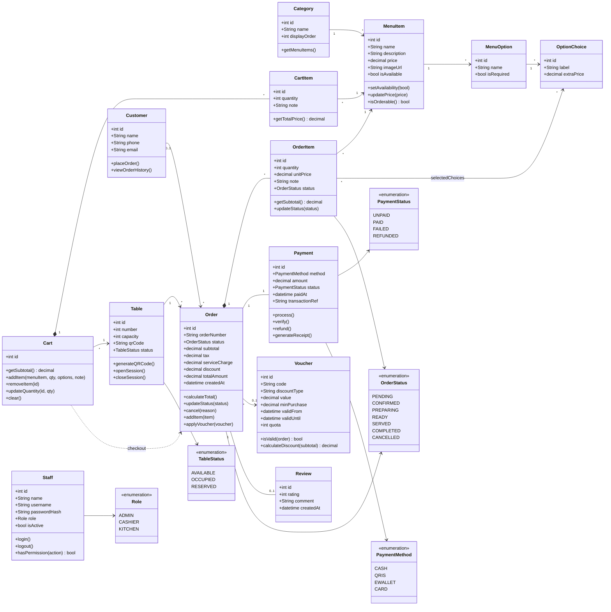
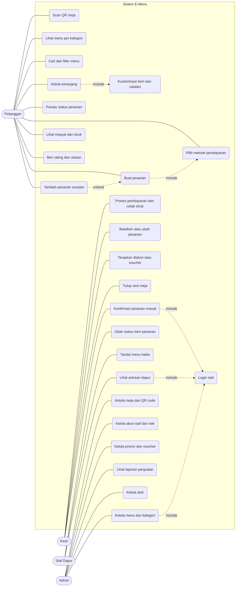
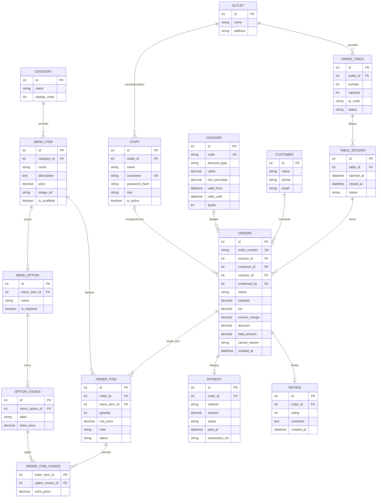

[README.md](https://github.com/user-attachments/files/34666918/README.md)
# PBO_Projeck
# 🍽️ Cavein: Sistem Pemesanan Menu Kafe / Restoran

## Latar Belakang dan Tujuan
 
Pemesanan di kafe dan restoran yang dilakukan secara manual membutuhkan waktu, bergantung pada ketersediaan pelayan, dan rawan salah catat antara meja, kasir, dan dapur. E-Menu dirancang sebagai sistem pemesanan digital berbasis QR code untuk mengatasi hal tersebut.
 
Tujuan proyek:
 
1. Merumuskan kebutuhan fungsional, kebutuhan non-fungsional, dan aturan bisnis sistem E-Menu.
2. Merancang class, use case, dan ERD yang menjadi dasar implementasi.
3. Memodelkan alur pemesanan dari pelanggan, kasir, dan dapur hingga laporan admin dengan pendekatan berorientasi objek.
4. Menyediakan kerangka kode awal sebagai titik mulai tahap implementasi.

## Daftar Isi

- [Aktor](#aktor)
- [Alur Singkat](#alur-singkat)
- [Kebutuhan Fungsional](#kebutuhan-fungsional)
- [Kebutuhan Non-Fungsional](#kebutuhan-non-fungsional)
- [Aturan Bisnis](#aturan-bisnis)
- [Desain Class](#desain-class)
- [Class Diagram](#class-diagram)
- [Use Case Diagram](#use-case-diagram)
- [ERD](#erd)
- [Contoh Kerangka Kode](#contoh-kerangka-kode)
- [Roadmap](#roadmap)
- [Kontribusi](#kontribusi)
- [Lisensi](#lisensi)

## Aktor

| Aktor | Peran |
|---|---|
| Pelanggan | Scan QR, melihat menu, memesan, membayar, memberi ulasan |
| Kasir | Mengonfirmasi pesanan, memproses pembayaran, menerapkan voucher, menutup sesi meja |
| Staf Dapur (Koki/Barista) | Mengelola antrean pesanan dan status item, menandai menu habis |
| Admin / Pemilik | Mengelola menu, meja, staf, promo, dan laporan |

## Alur Singkat

1. Pelanggan scan QR di meja, nomor meja terdeteksi otomatis.
2. Pelanggan memilih menu, mengatur kustomisasi (pedas, gula, topping), lalu checkout.
3. Pesanan masuk ke kasir dan layar dapur (kitchen display).
4. Dapur mengubah status: Diproses, lalu Siap. Pelanggan memantau status secara real-time.
5. Pesanan disajikan, dibayar, lalu sesi meja ditutup oleh kasir.

## Kebutuhan Fungsional

<b>Pelanggan (FR-01 s.d. FR-10)</b>

| ID | Kebutuhan |
|---|---|
| FR-01 | Mengakses menu dengan scan QR code meja (nomor meja terdeteksi otomatis) |
| FR-02 | Melihat menu per kategori (makanan, minuman, dessert) lengkap dengan foto, harga, deskripsi, dan status ketersediaan |
| FR-03 | Mencari dan memfilter menu (kategori, harga, vegetarian, dll.) |
| FR-04 | Mengelola keranjang, termasuk opsi kustomisasi dan catatan |
| FR-05 | Membuat pesanan dari keranjang |
| FR-06 | Memilih metode pembayaran (tunai di kasir, QRIS, e-wallet, kartu) |
| FR-07 | Memantau status pesanan (Diterima, Diproses, Siap, Disajikan) |
| FR-08 | Menambah pesanan susulan di meja yang sama |
| FR-09 | Melihat riwayat dan struk pesanan |
| FR-10 | Memberi rating dan ulasan |

<b>Kasir (FR-11 s.d. FR-15)</b>

| ID | Kebutuhan |
|---|---|
| FR-11 | Melihat dan mengonfirmasi pesanan masuk |
| FR-12 | Memproses pembayaran dan mencetak/mengirim struk |
| FR-13 | Membatalkan atau mengubah pesanan (dengan alasan) |
| FR-14 | Menerapkan diskon/voucher |
| FR-15 | Menutup sesi meja setelah pembayaran |

<b>Dapur (FR-16 s.d. FR-18)</b>

| ID | Kebutuhan |
|---|---|
| FR-16 | Melihat antrean pesanan berurutan (kitchen display) |
| FR-17 | Mengubah status item/pesanan (Diproses, Siap) |
| FR-18 | Menandai menu habis (stok kosong) |

<b>Admin (FR-19 s.d. FR-24)</b>

| ID | Kebutuhan |
|---|---|
| FR-19 | CRUD menu, kategori, harga, foto, dan opsi tambahan |
| FR-20 | Mengelola meja dan generate QR code per meja |
| FR-21 | Mengelola akun staf dan hak akses (role) |
| FR-22 | Mengelola promo, diskon, dan voucher |
| FR-23 | Laporan penjualan harian/bulanan, menu terlaris, dan pendapatan per metode bayar |
| FR-24 | Mengelola stok bahan/menu (opsional) |

## Kebutuhan Non-Fungsional

| Aspek | Kebutuhan |
|---|---|
| Performa | Halaman menu dimuat < 3 detik; mendukung minimal 100 pengguna bersamaan |
| Real-time | Status pesanan dan antrean dapur diperbarui otomatis (WebSocket/polling) |
| Keamanan | Hash password, role-based access, payment gateway resmi, perlindungan data pelanggan |
| Usability | Mobile-first, tanpa instal aplikasi, mudah dipakai tanpa pelatihan |
| Ketersediaan | Uptime ≥ 99%; pesanan tidak hilang saat koneksi terputus sesaat |
| Skalabilitas | Mendukung penambahan cabang/outlet |
| Maintainability | Arsitektur modular dan backup data harian |

## Aturan Bisnis

- Satu meja hanya punya satu sesi aktif; semua pesanan di meja itu masuk ke satu tagihan.
- Menu berstatus "habis" tidak bisa dipesan.
- Pesanan berstatus "Diproses" tidak bisa dibatalkan pelanggan.
- Pajak (PPN) dan service charge dihitung otomatis dari subtotal.
- Pesanan dianggap selesai setelah dibayar dan disajikan.

## Desain Class

**Enum**

| Enum | Nilai |
|---|---|
| `OrderStatus` | PENDING, CONFIRMED, PREPARING, READY, SERVED, COMPLETED, CANCELLED |
| `PaymentStatus` | UNPAID, PAID, FAILED, REFUNDED |
| `PaymentMethod` | CASH, QRIS, EWALLET, CARD |
| `TableStatus` | AVAILABLE, OCCUPIED, RESERVED |
| `Role` | ADMIN, CASHIER, KITCHEN |

**Class layanan (service)**

| Class | Tanggung jawab |
|---|---|
| `MenuService` | CRUD menu, kategori, ketersediaan, pencarian |
| `OrderService` | Membuat pesanan, mengubah status, membatalkan, menghitung total |
| `PaymentService` | Integrasi payment gateway, verifikasi, refund |
| `TableService` | Manajemen meja, sesi, generate QR |
| `KitchenDisplayService` | Antrean dapur, update status item |
| `NotificationService` | Push status pesanan ke pelanggan, kasir, dan dapur |
| `ReportService` | Laporan penjualan dan menu terlaris |
| `AuthService` | Autentikasi dan otorisasi staf |

## Class Diagram

## Use Case Diagram

## ERD

**Catatan desain database**

- `TABLE_SESSION` memastikan satu meja hanya punya satu sesi aktif dan satu tagihan.
- `OUTLET` disiapkan untuk dukungan multi-cabang.
- `unit_price` dan `extra_price` disimpan sebagai snapshot agar perubahan harga menu tidak mengubah pesanan lama.
- Cart cukup disimpan di sisi klien atau cache sementara, lalu menjadi `ORDERS` dan `ORDER_ITEM` saat checkout.

## Roadmap

- [x] Analisis kebutuhan dan aturan bisnis
- [x] Desain class, use case, dan ERD
- [ ] Implementasi backend (API menu, pesanan, pembayaran)
- [ ] Integrasi payment gateway (QRIS, e-wallet, kartu)
- [ ] Antarmuka pelanggan (mobile-first, tanpa instal)
- [ ] Kitchen display dan dashboard kasir real-time
- [ ] Dashboard admin dan laporan penjualan
- [ ] Dukungan multi-cabang

## Kontributor

| No | Nama | NIM | Peran |
|---|---|---|---|
| 1 | Farhat Bima Raditya (60225134) | [isi NIM] | Modul Menu |
| 2 | Zaki Rahul Fawas (60225135) | [isi NIM] | Modul Pesanan |
| 3 | Putra Agung Srihandaka (60225149) | [isi NIM] | Modul Pembayaran, Promo, dan Laporan |
| 4 | Muhammad Wafa (60225153) | [isi NIM] | Modul Meja, Staf, dan Dapur |
